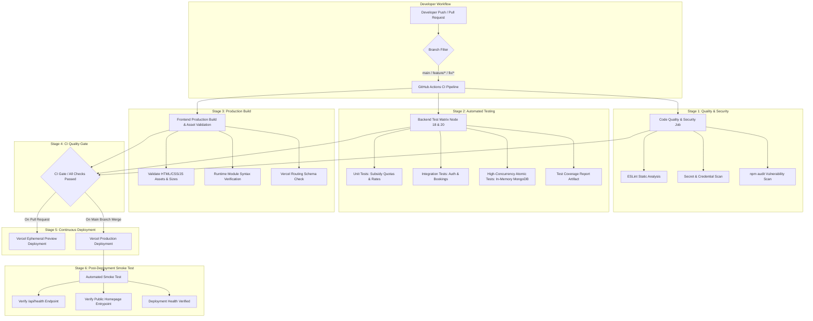

# KrishiSeva — Government Agriculture Booking & Subsidy Portal

[](https://krishi-seva-kappa.vercel.app)
[](https://github.com/NishantPatle06/KrishiSeva)

> 🌐 **Live Demo (Vercel)**: [https://krishi-seva-kappa.vercel.app](https://krishi-seva-kappa.vercel.app)

KrishiSeva is a full-stack booking system designed for government distribution of subsidized agricultural supplies (seeds and fertilizers). This project is specifically designed to demonstrate **high-concurrency safety** and **transaction verification** (like payment processing) to placement interviewers.

---

## 🚀 Key Architectural Features
1. **Subsidy Quota Control**: Restricts the maximum bags of subsidized goods a farmer can book based on land size.
2. **Concurrency-Safe Inventory Checks**: Uses atomic MongoDB updates (`$inc` and query limits) to guarantee stock never drops below zero, avoiding race conditions during peak load.
3. **Interactive Stress Tester**: A built-in frontend testing panel that lets you fire 10 concurrent requests simultaneously to demonstrate the difference between unsafe and safe endpoints.

---

## 🛠️ Tech Stack
*   **Frontend**: HTML5, Vanilla CSS3 (Custom Glassmorphic Dark UI), Vanilla JS
*   **Backend**: Node.js, Express.js
*   **Database**: MongoDB (Mongoose ODM)

---

## 📂 Project Structure
```
fullstack/
├── public/                 # Static frontend assets
│   ├── index.html          # Main UI
│   ├── style.css           # Premium styling
│   └── app.js              # Client state, rendering, and concurrency test runner
├── src/
│   ├── config/             # MongoDB connection setup
│   │   └── db.js
│   ├── models/             # Mongoose Schemas (Farmer, Supply, Booking)
│   ├── controllers/        # Business logic containing safe & unsafe endpoints
│   │   └── bookingController.js
│   ├── routes/             # API routes
│   │   └── api.js
│   └── server.js           # Server runner
├── scripts/
│   └── seed.js             # Script to populate initial database state
├── package.json            # Dependencies & start scripts
└── .env                    # Environment variables (port, db connection)
```

---

## ⚙️ Setup and Installation

### 1. Install Dependencies
Run the following command in the root folder to install dependencies:
```bash
npm install
```

### 2. Configure MongoDB
Ensure you have MongoDB running locally. The default connection URI is configured in `.env`:
```env
PORT=5000
MONGODB_URI=mongodb://127.0.0.1:27017/krishiseva
```

### 3. Seed Database
Load the initial mock farmer (Rajesh Kumar) and supplies (Wheat Seeds starting with exactly **10 bags** in stock):
```bash
npm run seed
```

### 4. Start Server
Run the Express application:
```bash
npm start
```
Open your browser and navigate to **[http://localhost:5000](http://localhost:5000)**.

---

## 🧠 Concurrency Demonstration (Interview Guide)

### 🔴 Unsafe Booking (Race Condition)
*   **Endpoint**: `/api/book/unsafe`
*   **Mechanism**: Read-Then-Write. The server fetches the stock level, checks if there's enough inventory, waits/processes for 1.5 seconds, then decrements stock and writes to the DB.
*   **The Bug**: If 10 requests hit the server concurrently, all 10 read the stock before any write has occurred. All 10 approve the purchase.
*   **Result**: Stock falls to **negative values** (e.g., stock starts at 10, but 10 bags are booked and Rajesh's quota usage goes past the limit).

### 🟢 Safe Booking (Atomic Validation)
*   **Endpoint**: `/api/book/safe`
*   **Mechanism**: Atomic updates. Utilizes Mongoose's `findOneAndUpdate` checking conditions on-the-fly:
    ```javascript
    const updatedSupply = await Supply.findOneAndUpdate(
      { _id: supplyId, stock: { $gte: quantity } },
      { $inc: { stock: -quantity } },
      { new: true }
    );
    ```
*   **The Guard**: MongoDB ensures operations are serialized. If the stock check `stock: { $gte: quantity }` fails during updates, no update is executed. The same pattern is applied to the Farmer's Quota.
*   **Result**: Inventory is correctly decremented, requests exceeding the available stock or farmer quota are safely rejected, and stock **never drops below 0**.

---

## 🔄 CI/CD Pipeline Architecture & Production Deployment

KrishiSeva features a fully automated, multi-stage CI/CD pipeline built with **GitHub Actions** and integrated with **Vercel** serverless hosting.

### 📐 Pipeline Flow Diagram



### ⚡ Workflow Triggers

| Workflow | File | Triggers | Purpose |
|---|---|---|---|
| **CI Pipeline** | `.github/workflows/ci.yml` | `push` to `main`, `feature/**`, `fix/**`; `pull_request` targeting `main` | Runs linting, secret checks, dependency audit, unit/integration/concurrency tests across Node 18 & 20, and frontend asset validation. |
| **Deploy & Verify** | `.github/workflows/deploy.yml` | On `workflow_run` (successful CI on `main`) or `workflow_dispatch` | Deploys to Vercel (via CLI if secrets configured or verifies Vercel Native Git deployment) and runs smoke tests. |
| **Smoke Test** | `.github/workflows/smoke-test.yml` | `deployment_status` (success), `workflow_dispatch` (manual) | Pings `/api/health` and homepage with retry backoff to validate deployment availability. |

---

## 🧪 Local Testing & Verification Commands

All quality gates in the CI pipeline can be executed locally:

```bash
# 1. Run ESLint code quality checks
npm run lint

# 2. Automatically fix linting issues
npm run lint:fix

# 3. Run production build & static asset verification
npm run build

# 4. Run full automated test suite (Unit, Integration, Concurrency)
npm test

# 5. Run unit tests only (Quota calculation algorithms)
npm run test:unit

# 6. Run integration and high-concurrency race condition tests
npm run test:integration

# 7. Generate test coverage report
npm run test:coverage

# 8. Check for secrets or credential leakage
npm run security:check

# 9. Scan dependencies for high/critical vulnerabilities
npm run audit:check

# 10. Run deployment smoke test against local or remote server
APP_URL=http://localhost:5000 npm run smoke-test
# Or against deployed Vercel instance:
APP_URL=https://krishi-seva-kappa.vercel.app npm run smoke-test
```

---

## 🔐 Environment Variables & Secrets Configuration

### 1. Local Development (`.env`)
Create a `.env` file in the project root (never committed to git):
```env
PORT=5000
MONGODB_URI=mongodb://127.0.0.1:27017/krishiseva

# Optional: Real Twilio SMS notifications
TWILIO_ACCOUNT_SID=ACXXXXXXXXXXXXXXXXXXXXXXXXXXXXXXXX
TWILIO_AUTH_TOKEN=your_auth_token_here
TWILIO_PHONE_NUMBER=+1234567890
```

### 2. GitHub Secrets (Repository Settings -> Secrets and variables -> Actions)
Required only if using GitHub Actions-driven Vercel deployments:

| Secret Name | Description | Required For |
|---|---|---|
| `VERCEL_TOKEN` | Personal Access Token generated from Vercel Account Settings -> Tokens | Actions CLI Deployments |
| `VERCEL_ORG_ID` | Vercel Team/User ID (found in `.vercel/project.json` or team settings) | Actions CLI Deployments |
| `VERCEL_PROJECT_ID` | Vercel Project ID (found in Vercel project settings) | Actions CLI Deployments |

> **Note**: If `VERCEL_TOKEN` is not configured, the repository uses **Vercel Native GitHub Integration**, which automatically triggers deployments directly from GitHub webhooks.

### 3. Vercel Production Environment Variables (Vercel Project -> Settings -> Environment Variables)
Configure the following in the Vercel dashboard:

| Variable Name | Environment | Description |
|---|---|---|
| `MONGODB_URI` | Production & Preview | Production MongoDB Atlas connection string |
| `TWILIO_ACCOUNT_SID` | Production (Optional) | Twilio Live Account SID |
| `TWILIO_AUTH_TOKEN` | Production (Optional) | Twilio Live Auth Token |
| `TWILIO_PHONE_NUMBER` | Production (Optional) | Twilio registered sender phone number |

---

## 🛡️ Recommended GitHub Branch Protection Rules

To prevent accidental production outages and enforce code quality, configure branch protection for `main` in GitHub (**Settings -> Branches -> Add branch protection rule**):

1. **Branch name pattern**: `main`
2. **Require a pull request before merging**:
   - Check *Require approvals* (minimum 1 approval recommended).
   - Check *Dismiss stale pull request approvals when new commits are pushed*.
3. **Require status checks to pass before merging**:
   - Check *Require branches to be up to date before merging*.
   - Required status checks:
     * `CI Gate / All Checks Passed`
     * `Code Quality & Security Audit`
     * `Backend Test Suite (18)`
     * `Backend Test Suite (20)`
     * `Frontend Production Build & Asset Validation`
4. **Do not allow bypassing the above settings**: Ensures all administrators must also pass CI checks.
5. **Prevent direct pushes**: Only allow changes via reviewed Pull Requests.

---

## 🩺 Deployment Health & Smoke Testing

The application exposes a production-ready health endpoint:

```http
GET /api/health
```
**Sample Response (HTTP 200)**:
```json
{
  "status": "ok",
  "timestamp": "2026-10-11T13:10:00.000Z",
  "service": "KrishiSeva Agricultural Portal",
  "database": "connected"
}
```
* Note: The health endpoint does not log or leak database credentials, passwords, or connection URIs.
* Root `/health` redirects to `/api/health`.
* The smoke test script `scripts/smoke-test.js` features configurable retry intervals (`SMOKE_MAX_ATTEMPTS`, `SMOKE_TIMEOUT_MS`, `SMOKE_RETRY_DELAY_MS`) to safely accommodate serverless cold starts.

---

## 🔍 Troubleshooting Failed CI Workflows

1. **`Code Quality & Security Audit` Failed**:
   - Run `npm run lint` locally to identify styling/syntax issues. Use `npm run lint:fix` to auto-format.
   - Run `npm run security:check` if secret scanning flagged suspicious token patterns.
   - Run `npm run audit:check`. If advisories appear in devDependencies, evaluate non-breaking updates with `npm audit fix`.

2. **`Backend Test Suite` Failed**:
   - Run `npm test` locally. All integration tests use an in-memory MongoDB instance (`mongodb-memory-server`) and do not depend on external database credentials.
   - If a concurrency test fails, verify that `Supply.findOneAndUpdate` still enforces `{ stock: { $gte: item.quantity } }` and `$inc: { stock: -item.quantity }`.

3. **`Frontend Production Build & Asset Validation` Failed**:
   - Run `node scripts/build.js` locally.
   - Verify that all static assets (`index.html`, `style.css`, `app.js`, images) are present in `public/` and are not empty or corrupted.

4. **Fresh Clone Reproduction**:
   ```bash
   git clone https://github.com/NishantPatle06/KrishiSeva.git
   cd KrishiSeva
   npm ci
   npm run lint
   npm run build
   npm test
   ```

